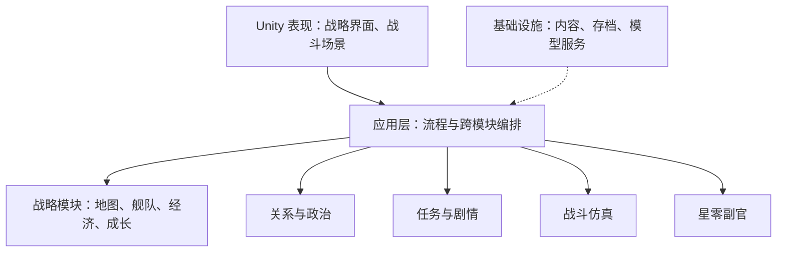

# 《小兵传奇》星际战争游戏：架构与并行开发规划

整理日期：2026 年 11 月 22 日  
项目仓库：https://github.com/gaozihao1216/NLP-project

> 本文将本次讨论整理为可供团队阅读与实施的设计建议。工作包、接口与目录均为建议方案，不代表已经在仓库中实现。代码示例用于说明接口形状，尚未构成完整、可编译的接口定义。

## 1. 项目背景与架构目标

项目拟以《小兵传奇》为世界观，采用 Unity 运行游戏、Blender 制作资产，构建战略与实时 3D 战斗相结合的单机游戏 Demo。

- 战略层：星图移动、舰队编成、经济补给、人物关系、政治行为、任务与剧情。
- 战斗层：玩家驾驶主舰，进行操舵、瞄准、开火，并指挥其他分队。
- 阵营：联邦、银鹰帝国、家族共用底层规则，通过初始条件、策略配置、成长资源与剧情内容体现差异。
- AI 副官：星零提供战前建议、战中提示和可选的设定问答。

核心目标是建立业务边界清楚、支持多人并行开发的架构：各模块不访问彼此的内部对象，不直接修改彼此状态，可以独立运行、测试和替换；模块间通过稳定接口协作。

推荐采用**单仓库、模块化单体**：模块在同一进程内通过 C# 接口交互，无需拆成独立网络服务。

### 1.1 阅读依据

- [README](https://github.com/gaozihao1216/NLP-project/blob/main/README.md)
- [初步设计](https://github.com/gaozihao1216/NLP-project/blob/main/proposal/初步的设计.txt)
- [系统架构设计](https://github.com/gaozihao1216/NLP-project/blob/main/proposal/原型设计/系统架构设计.md)
- [项目 proposal](https://github.com/gaozihao1216/NLP-project/blob/main/proposal/proposal.tex)
- [交互原型](https://github.com/gaozihao1216/NLP-project/blob/main/proposal/原型设计/prototype.html)

## 2. 现有设计需要保留和调整的部分

### 2.1 应当保留的原则

1. 三阵营共享系统，通过配置与策略体现差异。
2. 战略层与战斗层通过窄接口连接。
3. 先打通“剧情任务 → 星图机动 → 战斗 → 结果回写”的最小闭环。
4. 规则与 Unity 表现分离，避免帧率和场景对象影响业务规则。

### 2.2 需要调整的问题

| 当前设计 | 潜在问题 | 调整方案 |
| --- | --- | --- |
| Relation 依赖剧情、经济，Story 又依赖 Relation | 循环依赖，无法独立开发 | 各模块处理自身规则，跨模块组合交给应用层 |
| Battle 依赖成长，EnemyAI 依赖战略地图 | 战斗开发被战略系统阻塞 | 战斗只接收准备好的战场输入 |
| Story 读取所有模块状态，作为上层裁判 | 剧情逐渐成为控制全部业务的大类 | 剧情读取精选事实，输出待执行的效果 |
| 一个 Ship 同时容纳模板属性、长期状态、战场状态 | 战略、战斗和表现共享可变对象 | 拆成模板、持久状态、战斗状态与表现对象 |

“联邦前期资源由高层代管”还涉及资源支付主体、可执行命令和补给来源，不能仅通过 UI 隐藏实现。应由规则策略控制权限、支付和资源托管。

## 3. 八个可并行推进的工作包

工作包是任务分配单位，代码模块是业务边界，两者不必一一对应。

| 工作包 | 职责 | 对外交付 | 独立开发与验收方式 |
| --- | --- | --- | --- |
| A：战斗仿真 | 运动、武器、弹道、命中、伤害、分队、敌舰行为、胜负 | 战斗接口、快照、事件、结果 | 输入固定配置，在无 UI 环境运行完整战斗 |
| B：战斗表现与美术 | 3D 场景、舰模、相机、输入、HUD、特效、声音 | 可操作战斗场景 | 接假运行时，演示移动、开火、命中和沉没 |
| C：战略基础规则 | 星图移动、舰队编成、经济、补给、成长与解锁 | 战略命令接口、只读快照 | 用测试命令完成移动、补给、编成和晋升 |
| D：关系与政治 | 人物、派系、关系边、政治行为及后果 | 行为校验、关系变化、关系快照 | 用固定人物验证拉拢、举报等行为与后果 |
| E：任务与剧情 | 任务状态、节点、条件、选项、分支、结局 | 剧情视图、任务目标、效果请求 | 输入假事实，走通有分支的剧情 |
| F：战略界面 | 星图、资源、编成、关系、剧情界面 | 玩家命令和信息显示 | 接假战略接口完成页面与交互 |
| G：星零副官 | 战前建议、战中提示、设定问答 | 建议、提示、异步回答 | 固定情报输入，验证结果与断网降级 |
| H：内容、基础设施与集成 | 配置、校验、存档、场景切换、装配、构建 | 游戏入口、内容包、存档实现 | 装配假模块，运行完整游戏流程 |

H 应有明确负责人，但内容仍由业务负责人维护：A 维护舰船参数，E 维护剧情，H 维护统一格式、加载和校验。

**每个工作包从第一天起都应有独立演示入口。**

## 4. 总体架构与调用方向

架构同时落实三种边界：

1. 按业务划分模块，各自维护状态与规则。
2. 规则与表现分离，核心业务不依赖 Unity 场景对象。
3. 用应用层组织跨模块流程。



实线表示调用方向，虚线表示实现应用层所需的基础设施端口。业务模块不直接调用其他模块的实现。

例如：经济模块不知道剧情节点，剧情模块不知道舰船内部对象，战斗模块不知道玩家军衔，战斗画面不知道奖励算法，副官只能读取允许玩家获知的情报。

## 5. 状态所有权

| 模块 | 独占维护的状态 | 明确不负责 |
| --- | --- | --- |
| Navigation | 战略位置、移动进度、可通行状态 | 资源扣除、战场内移动 |
| Fleet | 持久舰船身份、舰队编成、战后舰船状态 | 战场逐帧血量、3D 对象 |
| Economy | 账户、库存、生产与补给记录 | 军衔、剧情推进 |
| Progression | 军功、军衔、能力和解锁 | 命中和伤害 |
| Relations | 人物与派系关系、政治状态 | 剧情节点、资源余额 |
| Narrative | 剧情节点、选项记录、任务进度 | 直接修改经济和关系 |
| Combat | 单场战斗的实体、弹丸、冷却、目标状态 | 长期舰队、奖励、任务存档 |
| Officer | 对话历史、提示冷却等自身状态 | 修改其他模块的权威状态 |

### 5.1 舰船对象的四种表示

| 对象 | 含义 | 所属 |
| --- | --- | --- |
| ShipDefinition | 舰种基础属性，类似产品规格 | 内容配置 |
| OwnedShipState | 玩家具体拥有的舰船、改装、长期损伤 | Fleet |
| CombatShipState | 本场战斗的位置、血量、装填状态 | Combat |
| ShipView | 模型、尾焰、炮口、动画、音效 | Unity 表现 |

通过 ID 和初始化数据关联，不共享一个可随意修改的 Ship 对象。

## 6. 跨模块流程与战斗结算

以“战斗后晋升，并引发政治事件”为例：

1. Combat 返回战损、目标完成情况、耗时等事实。
2. 应用层验证对应任务、战斗身份及是否已经结算。
3. Fleet 根据战损计算舰船更新。
4. Economy 根据补给和奖励策略计算资源更新。
5. Progression 根据任务与战斗事实计算军功和晋升。
6. Relations 根据政治规则计算关系变化。
7. 应用层提交完整更新。
8. Narrative 根据提交后的事实推进剧情，界面刷新。

**奖励规则由战略侧决定，战斗层提供事实。**调整成长曲线不应要求修改战斗仿真。

### 6.1 应用层按工作流组织

```text
StartCampaign
TravelToSystem
AcceptMission
LaunchBattle
SettleBattle
ChooseStoryOption
PerformPoliticalAction
SaveCampaign
LoadCampaign
```

每个工作流类负责一个用户行为或业务流程，避免把所有逻辑放进巨大的 GameManager。

### 6.2 结算的正确性约束

- **只结算一次**：使用 BattleId 记录结算状态，重复结果不能重复发奖。
- **避免部分结算**：先在候选状态中完成验证和完整更新，成功后提交并保存，失败则保留原状态。
- **提交后再通知**：剧情与界面读取已提交的事实，避免根据未完成的结算提前推进。

单机项目可以用候选状态与一次完整提交实现，无需引入复杂数据库事务。

## 7. 关键接口建议

以下示例用于说明契约形状，字段与生命周期需要团队共同确认。

### 7.1 战斗运行接口

```csharp
public interface ICombatRuntime
{
    void Initialize(BattleStartSpec spec);

    CommandResult Submit(CombatCommand command);

    // 一次调用推进一个约定长度的仿真步。
    void Step();

    BattleSnapshot ReadSnapshot();

    BattleEvent[] DrainEvents();

    bool TryGetResult(out BattleResult result);
}
```

| 契约 | 内容与约束 |
| --- | --- |
| BattleStartSpec | 敌我编成、解析后的战斗属性、出生点、战场布局、目标、随机种子 |
| CombatCommand | 操舵、瞄准、开火、分队指令；通过 ID 指定目标 |
| BattleSnapshot | 只读状态，不暴露内部可变实体和集合 |
| BattleEvent | 开火、命中、摧毁等瞬时反馈，供特效和音效消费 |
| BattleResult | 战斗事实，不直接指定下一剧情节点或最终军功奖励 |

建议用 TryGetResult 或 CompleteBattle 表达结果读取或完成操作，替代含义不够清楚的 Finalize 命名。

### 7.2 剧情接口

```csharp
public interface INarrativeRuntime
{
    NarrativeUpdate Evaluate(NarrativeFacts facts);

    StoryView ReadCurrentView();

    StoryDecision Choose(
        StoryChoiceId choiceId,
        NarrativeFacts facts);
}
```

NarrativeFacts 只提供剧情所需事实，例如当前星系、军衔、可用于判断的资源、指定人物关系值、任务完成情况和已提交的战斗摘要。

StoryDecision 表达选项是否合法，以及希望执行哪些效果。应用层将效果交给对应模块校验、执行。剧情可以请求增加关系值，但不能直接访问关系图内部对象。

### 7.3 星零副官接口

```text
IStrategicAdvisor       战前情报分析与建议
ITacticalHintProvider   战斗中的规则提示
IOfficerDialogue        异步对话与设定问答
```

三者可以共用界面入口，但执行方式分离：

- 战前建议和战中提示先采用规则实现。
- 大模型对话异步执行，提供超时与降级。
- 大模型调用不进入战斗推进链路。
- 副官接收玩家可见情报，不能读取未发现敌舰、隐藏剧情等完整内部状态。

## 8. 推荐仓库目录

采用一个 Unity 项目，在项目内部通过独立包组织代码。

```text
NLP-project/
    proposal/                         已有设计资料
    docs/
        architecture.md
        development-plan.md
        contracts/
        decisions/

    content/
        ships/
        factions/
        star-maps/
        relations/
        missions/
        stories/

    tools/
        ContentValidator/
        ContentExporter/

    game/
        Assets/
            Game/
                Bootstrap/
                Scenes/
                Prefabs/
                Art/
                Audio/
                Settings/

        Packages/
            manifest.json
            com.starpawn.foundation/
            com.starpawn.navigation/
            com.starpawn.fleet/
            com.starpawn.economy/
            com.starpawn.progression/
            com.starpawn.relations/
            com.starpawn.narrative/
            com.starpawn.combat/
            com.starpawn.officer/
            com.starpawn.application/
            com.starpawn.infrastructure/
            com.starpawn.presentation/

        ProjectSettings/
```

### 8.1 业务模块内部结构

以战斗模块为例：

```text
com.starpawn.combat/
    package.json

    Runtime/
        Contracts/         公开接口、命令、快照、结果
        Domain/            实体、规则、系统、运行时

    Tests/
        ContractTests/
        DomainTests/

    Samples~/
        MinimalEncounter/
```

战斗规则内部进一步划分：

```text
Commands/
Movement/
Weapons/
Projectiles/
Collision/
Damage/
Squads/
EnemyPolicies/
Objectives/
Snapshots/
```

分队和敌舰行为都输出战斗命令，再经过统一规则执行，不能绕过装填、射程和移动限制。

### 8.2 应用、表现与基础设施

```text
com.starpawn.application/Runtime/
    Campaign/
    Travel/
    Missions/
    BattleLaunch/
    BattleSettlement/
    StoryChoices/
    Persistence/

com.starpawn.presentation/Runtime/
    Strategic/
    Combat/
    Officer/

com.starpawn.infrastructure/Runtime/
    Content/
    SaveFiles/
    DialogueProviders/
```

Contracts 属于各自模块，不要集中到巨大的 Common 或 Shared 包。Foundation 只放少量稳定基础类型，例如 ID、错误、时间与随机源抽象，不放 PlayerState、GameManager 或完整游戏状态。

## 9. 通过程序集落实边界

目录与口头约定不足以阻止耦合，应使用 Unity 的程序集定义文件（.asmdef）约束依赖。

| 程序集 | 允许引用 | 禁止引用 |
| --- | --- | --- |
| Combat.Domain | 自己的 Contracts、Foundation | Unity、剧情、经济、成长实现 |
| Narrative.Domain | 自己的 Contracts、Foundation | 其他业务模块 Domain |
| 其他业务 Domain | 自己的 Contracts、Foundation | 其他业务模块内部实现 |
| Application | 各模块 Contracts | Unity 场景对象 |
| Presentation | 应用接口、所需只读契约、Unity | 各业务模块 Domain |
| Infrastructure | 所需契约、文件或外部服务 SDK | 游戏业务流程 |
| Bootstrap | 装配所需的具体实现 | 具体业务规则 |

内部实现默认不公开。具体依赖在编译阶段接受检查。

### 9.1 仿真与 Unity 的职责

1. 运动和命中的最终裁决只能有一个来源。如果采用纯 C# 仿真，Unity 刚体不能同时决定真实舰船位置和伤害。
2. 表现层读取仿真快照，可以插值显示，但不能把插值结果写回规则状态。
3. 固定步长有助于稳定推进，不自动保证跨平台完全确定。第一版先保证固定环境下可复现。

## 10. 并行开发机制

并行开发的前提是同时准备四样东西：**契约、样例、假实现、验收条件**。

| 开发方 | 开发时使用的替代对象 |
| --- | --- |
| 战斗仿真 | 固定 BattleStartSpec，无需等待战略系统 |
| 战斗表现 | FakeCombatRuntime，按预设轨迹产生移动、开火、命中 |
| 战略流程 | FakeCombatRuntime，立即返回胜利或失败结果 |
| 星零副官 | 固定的玩家可见情报快照 |
| 剧情 | 固定军衔、资源、关系与任务事实 |
| 战略界面 | FakeCampaignFacade，提供页面数据 |

### 10.1 第一轮共同约定

1. 实体 ID 和内容 ID 格式。
2. 战斗开始与战斗结果的数据格式。
3. 战略命令和错误返回方式。
4. 剧情事实与效果类型。
5. 阵营能力、资源托管和解锁策略。
6. 坐标、单位、仿真步长和时间推进方式。
7. 内容版本和存档版本。

尤其要明确：实时战斗持续五分钟，战略经济是推进五分钟、推进一个回合，还是暂停？此规则必须统一，不能由各模块分别猜测。

### 10.2 从第一周开始联调

先保持一个极小但完整的流程：

**接任务 → 移动 → 启动假战斗 → 返回结果 → 奖励结算 → 下一段剧情。**

之后逐步替换假实现。每次替换只检验对应契约和完整流程，避免最后一次性集成所有模块。

## 11. 两人团队的分工建议

小组实际是两人，八个工作包按下面的方式合并。战斗与战略分属两人，互不阻塞：

| 成员 | 主责工作包 | 配合工作 |
| --- | --- | --- |
| A | A 战斗仿真、B 战斗表现 | 战斗参数、场景与手感调试 |
| B | C 战略规则、D 关系政治、E 任务剧情、F 战略界面、G 星零副官、H 基础设施与集成 | 内容编写、装配与构建验证 |

两人的接口就是 `Contracts` 层与 `CampaignFacade`。A 只改 `combat` 包，B 改其余模块与 `application`；换实现只动 `GameBootstrap.Create()`。

压力集中在 B 这一侧：战略、剧情、界面、整合都在这里。对策是界面先做只读快照消费方，剧情先跑通一条最小链路，其余内容延后；不要再把边界工作推给 A。

两项交付约束：

- 领域开发者同时交付样例配置、假实现和可运行演示。
- 整合负责人负责装配，不承担替所有人补接口、编写规则和整理内容的工作。

原 proposal 把作战和地图交给同一人，容易让战斗阻塞战略。现在战斗独立给 A，地图留在 B，二者通过 `BattleStartSpec` 的星系锚点与结算事务对接。

## 12. 阶段计划与验收结果

| 阶段 | 必须得到的结果 |
| --- | --- |
| 起步阶段 | 契约、假实现、独立演示场景、完整假闭环 |
| 第一轮开发 | 真实战斗与真实战略规则分别可运行 |
| 第一轮整合 | 一场真实战斗能回写舰队、资源、成长和剧情 |
| 内容阶段 | 一条短阵营流程，包含有后果的选择和失败路径 |
| 完成阶段 | 存读档、操作反馈、性能与展示流程稳定 |
| 扩展阶段 | 第二阵营、额外分队指令、图形关系网、LLM 对话 |

第一版只承诺：**一个阵营、一小片星图、一条短任务链、一套基础战斗、一个政治选择，以及完整存读档。**

第二阵营应尽早使用少量测试内容验证配置和策略能力，完整剧情可以后做，以验证共享架构而不承担三倍内容量。

## 13. 架构验收标准

一个模块是否真正独立，可以用以下问题检验：

- 战斗修改伤害算法时，剧情与经济是否无需修改？
- 剧情增加分支时，战斗和界面是否只需遵守既有契约？
- 界面更换关系图呈现方式时，关系规则是否不变？
- 大模型服务不可用时，核心游戏流程是否仍能运行？
- 战斗结果重复返回时，是否不会重复加奖？
- 任何模块是否都能使用固定数据和假依赖独立演示？

实现这些要求，比单纯增加目录层级更能证明边界清晰、支持并行开发。
